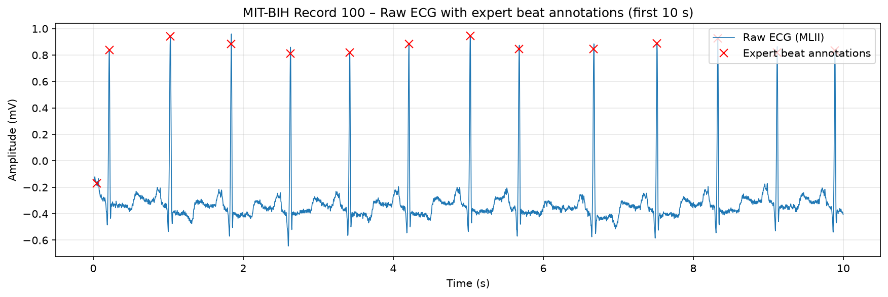
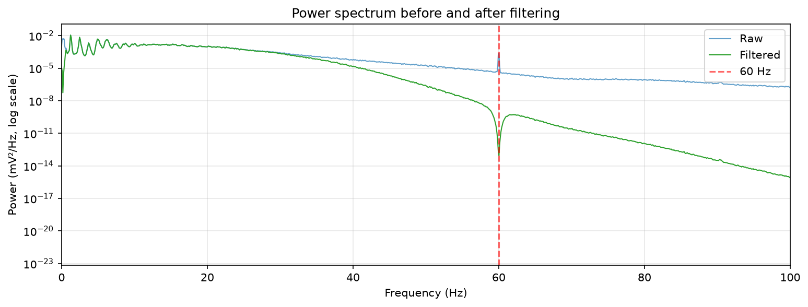
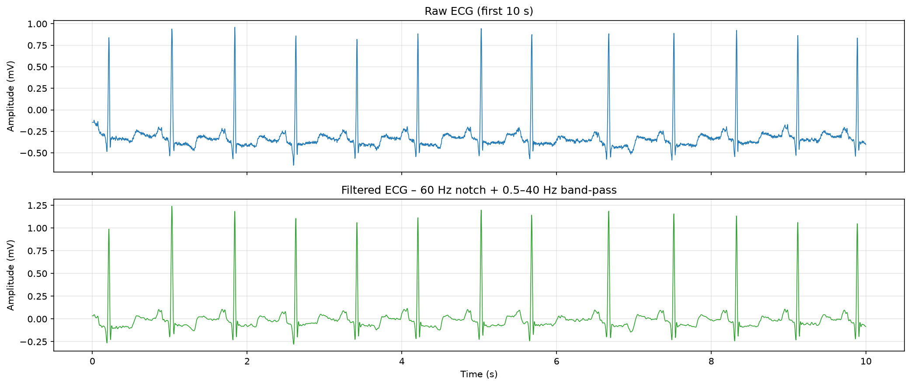
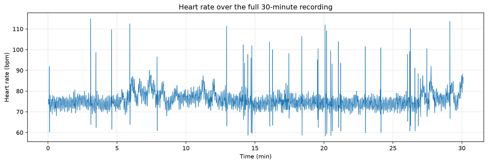
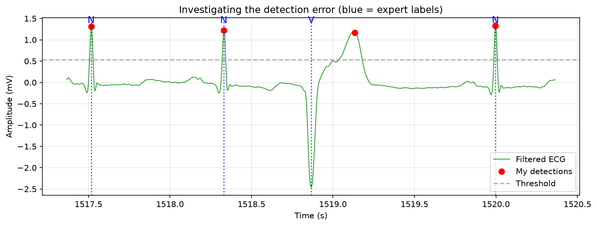

# ECG Signal Processing & Heartbeat Detection

Filtering, frequency analysis and R-peak (heartbeat) detection on real ECG data from the
MIT-BIH Arrhythmia Database, using Python, NumPy, SciPy and Matplotlib. The detector is
evaluated against cardiologist-annotated beats.

## Results (MIT-BIH record 100, 30 min, 360 Hz)

| Metric | Detector v1 (upward peaks) | Detector v2 (absolute value) |
|---|---|---|
| Expert-annotated beats | 2,273 | 2,273 |
| True positives | 2,272 | 2,273 |
| Missed beats (FN) | 1 | 0 |
| False detections (FP) | 1 | 0 |
| Sensitivity | 99.96% | 100.00% |
| Positive predictivity | 99.96% | 100.00% |

Matching tolerance: 150 ms (as used in ANSI/AAMI EC57). Mean timing offset vs expert marks: 0.2 ms (v1).

| Heart-rate metric | All beats | Normal-to-normal (NN) only |
|---|---|---|
| Mean heart rate | 75.8 bpm | 75.5 bpm |
| SDNN | 48.0 ms | 36.0 ms |
| RMSSD | 61.4 ms | 27.9 ms |

## What I did

### 1. Load and inspect the signal — `01_load_and_plot_ecg.ipynb`
Loaded record 100 (MLII lead) with `wfdb`, plotted the raw signal with the expert beat
annotations, and identified the P wave, QRS complex and T wave of a single beat.



### 2. Frequency analysis and filtering — `02_filtering_and_frequency_analysis.ipynb`
- Estimated the power spectrum with Welch's method. It showed a clear **60 Hz power-line
  peak**, most ECG power below ~20 Hz, and harmonics of the heart rate (~1.25 Hz).
- Applied a **60 Hz notch filter (Q = 30)** and a **4th-order Butterworth band-pass
  (0.5–40 Hz)**, both **zero-phase** (`filtfilt` / `sosfiltfilt`) so R-peak timing is not shifted.
- Result: baseline offset and wander removed, 60 Hz peak eliminated, high-frequency noise
  strongly attenuated.




**Trade-off noted:** the 0.5 Hz high-pass slightly distorts the ST segment. That is
acceptable for heart-rate detection, but diagnostic ECG typically uses a ~0.05 Hz cutoff.

### 3. R-peak detection, heart rate and HRV — `03_rpeak_detection_and_heart_rate.ipynb`
- Detected R-peaks with `scipy.signal.find_peaks` using an amplitude threshold and a
  minimum beat spacing.
- Computed RR intervals, instantaneous heart rate, **SDNN** and **RMSSD**.
- The heart-rate trace shows paired spikes and dips from premature beats (short RR
  followed by a compensatory pause). Excluding non-normal beats more than halved RMSSD,
  which is why clinical HRV uses NN intervals.



### 4. Evaluation and error analysis
Detections were matched one-to-one with the expert annotations. Detector v1 missed the
recording's single **premature ventricular contraction (PVC)**: the beat was inverted
(about −2.45 mV), so the upward-peak rule skipped it and instead picked up its T wave
260 ms later, causing one miss and one false detection.



**Fix (v2):** detect on the absolute value of the filtered signal, with a 0.30 s minimum
spacing so the PVC's T wave is suppressed. This resolved both errors on record 100.

## Limitations
- Evaluated on **one record** (100), which is relatively clean. v2 was adjusted after
  seeing this record's error, so its 100% result needs validating on other records.
- Fixed thresholds: noisier recordings or very high heart rates (>200 bpm) may need
  adaptive thresholds.
- HRV figures come from a single 30-minute recording and are not clinical measurements.

## Next steps
- Evaluate on all 48 MIT-BIH records and report overall sensitivity and positive predictivity.
- Implement the Pan–Tompkins algorithm (derivative, squaring, moving-window integration,
  adaptive thresholds) and compare.
- Add frequency-domain HRV (LF/HF power).

## How to run
```bash
git clone https://github.com/Kolawole162/electrocardiogram_ecg_signal_processing.git
cd electrocardiogram_ecg_signal_processing
python -m venv venv
venv\Scripts\activate        # Windows  (macOS/Linux: source venv/bin/activate)
pip install -r requirements.txt
python -m notebook
```
The ECG data is streamed from PhysioNet the first time each notebook runs.

## Data and references
- Moody GB, Mark RG. *The impact of the MIT-BIH Arrhythmia Database.* IEEE Engineering in
  Medicine and Biology 20(3):45–50 (2001).
- Goldberger AL, et al. *PhysioBank, PhysioToolkit, and PhysioNet.* Circulation
  101(23):e215–e220 (2000).
- Data: [MIT-BIH Arrhythmia Database on PhysioNet](https://physionet.org/content/mitdb/)

## Tools
Python · NumPy · SciPy · Matplotlib · pandas · wfdb · Jupyter
